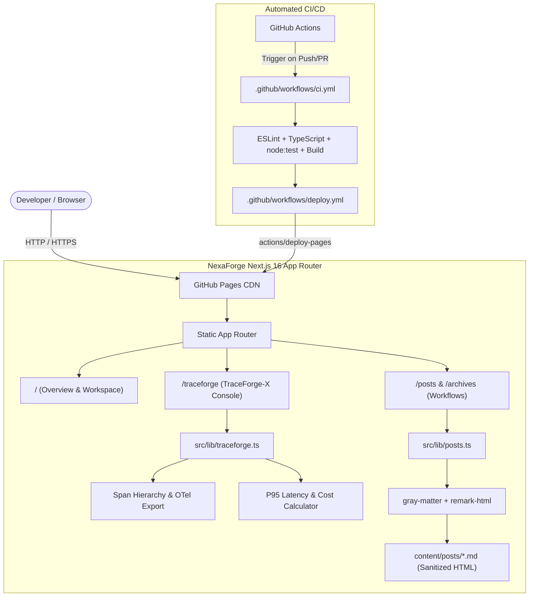

<div align="center">

# Vorlixen

**A Developer-First Workspace & Distributed Observability Platform for AI & MLOps Pipelines**

[](https://github.com/ZitouniNidhal/nexaforge/actions/workflows/ci.yml)
[](https://github.com/ZitouniNidhal/nexaforge/actions/workflows/deploy.yml)
[](./LICENSE)
[](https://nextjs.org)
[](https://www.typescriptlang.org)
[](https://react.dev)

</div>

---

## The Problem NexaForge Solves

Building, testing, and shipping production-grade AI systems requires more than isolated notebooks or generic SaaS dashboards:

1. **The Telemetry Blind Spot**: Teams lack sub-millisecond visibility into where time, tokens, and dollars are spent across complex multi-step pipelines (retrieval, vector similarity search, model inference, safety guardrails).
2. **Scattered Engineering Rituals**: Knowledge, operational postmortems, and workflow runbooks drift apart from the tools used to inspect live pipeline traces.
3. **Bloated Infrastructure Overhead**: Most observability and team collaboration portals require heavy proprietary SaaS agents, complex clusters, or costly vendor locks.

**NexaForge** solves this by unifying a **developer-centric workspace** with **TraceForge-X** — an interactive distributed telemetry suite — alongside Markdown-driven engineering workflows, hosted 100% statically on GitHub Pages with zero external hosting dependencies.

---

## Intended Audience

- **MLOps & Platform Engineers**: Instrumenting and auditing distributed model pipelines, latency bottlenecks, and token accounting.
- **AI Product Engineers**: Tracing RAG flows, evaluation benchmark gates, and guardrail validation.
- **Systems & Infrastructure Developers**: Exploring eBPF-based kernel telemetry for low-overhead network and model observability.

---

## Implemented Features vs. Planned Research

To maintain total transparency with contributors, here is the exact breakdown between active code and future roadmap items:

| Capability | Status | Implementation Details |
|---|---|---|
| **TraceForge-X Waterfall** | :white_check_mark: **Implemented** | Interactive timeline rendering of parent-child spans with latency bars, service badges, and error flags in `src/app/traceforge/page.tsx`. |
| **Differential Behavioral Analysis** | :white_check_mark: **Implemented** | A/B execution trace comparison engine in `src/lib/behavioral.ts` computing latency delta, token shift, and anomaly severity flags. |
| **Hypothesis & Provenance Workbench** | :white_check_mark: **Implemented** | Falsifiable behavioral hypotheses with root cause categories, confidence scoring, and concrete span evidence provenance. |
| **Automated Regression Test Generator** | :white_check_mark: **Implemented** | In-browser generator producing executable native `node:test` code snippets from detected trace anomalies and verified hypotheses. |
| **Span Inspector & Metadata** | :white_check_mark: **Implemented** | Attributes inspection (`llm.model`, `cache.hit`, `db.system`, HTTP status) and error diagnostics in `src/lib/traceforge.ts`. |
| **Token & Cost Accounting** | :white_check_mark: **Implemented** | Aggregate token metrics and dollar cost estimation dynamically calculated across execution traces. |
| **In-Browser OTel Export** | :white_check_mark: **Implemented** | Download trace sessions directly formatted in OpenTelemetry (OTel) JSON schema. |
| **Persistent Behavioral Memory** | :white_check_mark: **Implemented** | LocalStorage persistence preserving custom simulation runs across browser refreshes. |
| **Markdown Content Engine** | :white_check_mark: **Implemented** | Filesystem-backed post retrieval with strict XSS sanitization (`remark-html`), SSG pre-rendering (`generateStaticParams`), and year grouping. |
| **100% GitHub Actions Hosting** | :white_check_mark: **Implemented** | Static export (`output: 'export'`) automatically tested and deployed to GitHub Pages via `.github/workflows/deploy.yml`. |
| *Native eBPF Daemon (C/Go)* | :hourglass_flowing_sand: *Planned Research* | Real kernel-level socket filter daemon attaching to host network interfaces (currently modeled via telemetry simulators). |
| *Live OTel gRPC Collector* | :hourglass_flowing_sand: *Planned Research* | Direct ingestion endpoint for OpenTelemetry collector agents via gRPC/HTTP stream. |
| *Multi-Tenant Auth & RBAC* | :hourglass_flowing_sand: *Planned Research* | GitHub OAuth and permission-scoped workspace collaboration. |

---

## Architecture Overview



---

## Getting Started

### Prerequisites
- **Node.js**: `v20.x` or `v21.x`
- **npm**: `v10.x`+

### Quick Start

```bash
# 1. Clone the repository
git clone https://github.com/ZitouniNidhal/nexaforge.git
cd nexaforge

# 2. Install dependencies
npm install

# 3. Start local development server
npm run dev
```

Visit [http://localhost:3000](http://localhost:3000) to view the portal, or jump directly to [http://localhost:3000/traceforge](http://localhost:3000/traceforge) to explore the tracing suite.

---

## Quality Gates & Verification

Contributors can reproduce all continuous integration checks locally with verified single-command execution:

```bash
# Run ESLint (must exit with 0 errors and 0 warnings)
npm run lint

# Run strict TypeScript compilation check
npm run typecheck

# Run automated unit test suite (node:test)
npm test

# Run static HTML production export (generates ./out)
npm run build
```

---

## Actionable Contribution Opportunities

We have identified **7 concrete, well-scoped opportunities** directly in the current codebase for new contributors:

### 1. `good first issue` — Add Search & Filter Debounce to TraceForge-X
- **Module:** `src/app/traceforge/page.tsx`
- **Problem:** Currently, the search input re-filters the trace array on every keystroke.
- **Expected Behavior:** Add a lightweight 150–200ms debounce to the search query state to prevent redundant filtering passes.
- **Acceptance Criteria:** Fast typing doesn't recompute `filteredTraces` on every keypress; typing delay is imperceptible.

### 2. `good first issue` — One-Click Copy for Trace ID & Span ID
- **Module:** `src/app/traceforge/page.tsx`
- **Problem:** Copying long hex trace IDs (e.g. `tr-7f9a12c4b8e0`) requires manual text selection.
- **Expected Behavior:** Add an icon button with clipboard interaction and a 2-second checkmark visual confirmation.
- **Acceptance Criteria:** Clicking copies ID to system clipboard; accessible `aria-label` included.

### 3. `good first issue` — Estimated Reading Time for Workflow Posts
- **Module:** `src/lib/posts.ts` and `src/app/posts/page.tsx`
- **Problem:** Readers cannot gauge the depth of a workflow post before clicking.
- **Expected Behavior:** Calculate estimated reading time based on a standard 200 words-per-minute heuristic from Markdown content.
- **Acceptance Criteria:** `PostMeta` contains `readingTimeMinutes: number`; displayed cleanly on `/posts` alongside the date.

### 4. `help wanted` — Hierarchical Span Tree / Flamegraph View
- **Module:** `src/app/traceforge/page.tsx`
- **Problem:** Spans are currently listed sequentially with relative timeline bars.
- **Expected Behavior:** Add a view toggle button ("Waterfall" vs. "Tree") that renders nested parent-child span indentation using each span's `parentId`.
- **Acceptance Criteria:** Children spans nest under parent spans; collapsibility support is a bonus.

### 5. `help wanted` — Post Tagging & Topic Filtering
- **Module:** `src/lib/posts.ts`, `src/app/posts/page.tsx`, `src/app/archives/page.tsx`
- **Problem:** Posts can only be discovered chronologically.
- **Expected Behavior:** Support optional `tags: string[]` in Markdown frontmatter; render interactive filter chips on `/posts`.
- **Acceptance Criteria:** Clicking a tag filters the list to matching articles; gracefully handles posts without tags.

### 6. `help wanted` — Local Storage Persistence for Simulated Traces
- **Module:** `src/app/traceforge/page.tsx`
- **Problem:** Simulated traces generated via "Simulate Run" are lost on browser refresh.
- **Expected Behavior:** Sync custom simulated traces with browser `localStorage`, with an option to restore initial defaults.
- **Acceptance Criteria:** Refreshing page retains added simulation traces; handles storage quota errors gracefully.

### 7. `help wanted` — RSS / Atom Feed Generation
- **Module:** `src/app/feed.xml/route.ts`
- **Problem:** Engineers cannot subscribe to new workflows and engineering notes via RSS readers.
- **Expected Behavior:** Add an App Router route handler generating a standard RSS 2.0 / Atom XML feed from `getAllPosts()`.
- **Acceptance Criteria:** Valid XML output validated with an online feed validator; linked in `Footer.tsx`.

---

## Maintainer Workflow & Community Standards

- **Pull Request Review SLA**: Maintainers aim to review pull requests within 3–5 business days.
- **Transparent Decisions**: PR rejections or change requests will always include constructive explanations and actionable suggestions.
- **Contributor Attribution**: All contributors are credited in release notes and commit history.
- **Scope Discipline**: Large architectural rewrites without prior issue discussion will be politely redirected to a Research Proposal issue first.

---

## Recommended Repository Metadata

- **GitHub Description**: `Developer-first platform & distributed observability workspace for AI and MLOps pipelines. Built with Next.js 16, React 19, TypeScript, and OpenTelemetry standards.`
- **Repository Topics**: `mlops`, `ai-observability`, `distributed-tracing`, `opentelemetry`, `ebpf`, `developer-tools`, `nextjs`, `react19`, `typescript`, `tailwind-css`
- **Social Preview Concept**: Dark developer terminal showing the TraceForge-X waterfall timeline (`#0d1117`), cyan span duration bars, and the NexaForge gradient rocket logo with live latency KPI pills.

---

## License

This project is licensed under the [MIT License](./LICENSE). Contributions made to NexaForge are accepted under the same license terms.
